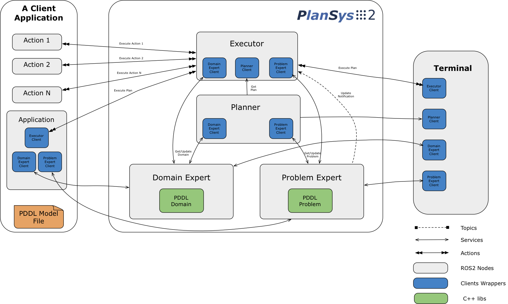
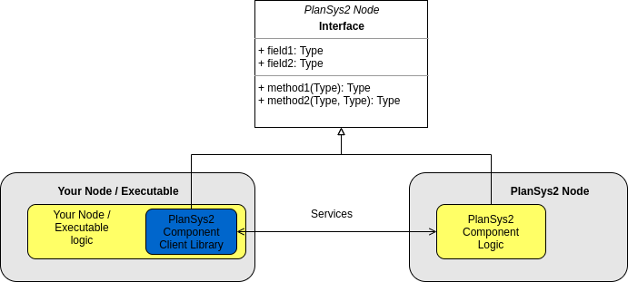
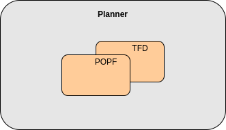
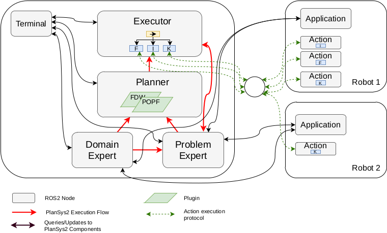
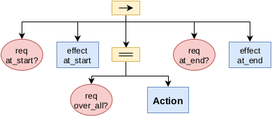
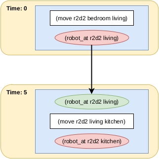
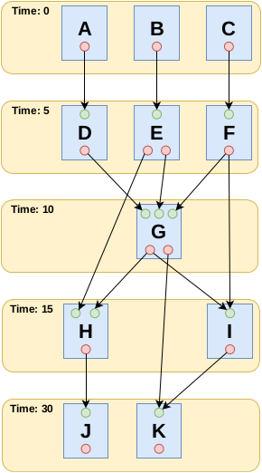
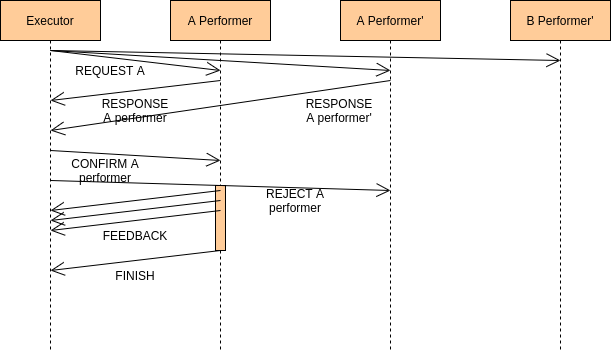

.. _design:

PlanSys2 design
###############

|PN| is made of four ROS 2 lifecycle nodes:

* **Domain Expert** (``domain_expert``): the PDDL domain: types, constants, predicates, functions,
  derived predicates, actions, processes and events.
* **Problem Expert** (``problem_expert``): the knowledge of the world: instances, predicates,
  functions with their values, goal, metric and constraints. It also simulates the PDDL+
  dynamics and applies the timed facts.
* **Planner** (``planner``): computes plans with plan solver plugins (Kairos by default).
* **Executor** (``executor``): executes a plan as a behavior tree, asking the *action
  performers* (the nodes that implement each action) to do each action.

Every name on this page is relative: a namespace given to |PN| applies to all of them.
Applications use them through the client libraries (C++ and Python), which hide the services
and actions.

Interfaces at a glance
**********************

Everything that enters and leaves |PN|. The details of each one are in the section of its node.

.. list-table:: Actions
   :header-rows: 1
   :widths: 30 35 35

   * - Action
     - Type
     - Server
   * - ``execute_plan``
     - ``plansys2_msgs/action/ExecutePlan``
     - executor

.. list-table:: Topics
   :header-rows: 1
   :widths: 28 30 22 20

   * - Topic
     - Type
     - Published by
     - Subscribed by
   * - ``domain_expert/domain``
     - ``std_msgs/msg/String``
     - domain expert
     - problem expert, executor, domain expert clients
   * - ``problem_expert/problem``
     - ``plansys2_msgs/msg/Problem``
     - problem expert
     - problem expert clients
   * - ``problem_expert/update_notify``
     - ``std_msgs/msg/Empty``
     - problem expert
     - problem expert clients
   * - ``problem_expert/knowledge``
     - ``plansys2_msgs/msg/Knowledge``
     - problem expert
     - executor, tools
   * - ``executing_plan``
     - ``plansys2_msgs/msg/Plan``
     - executor
     - tools
   * - ``remaining_plan``
     - ``plansys2_msgs/msg/Plan``
     - executor
     - (applications)
   * - ``action_execution_info``
     - ``plansys2_msgs/msg/ActionExecutionInfo``
     - executor
     - tools
   * - ``executor/execution_trace``
     - ``plansys2_msgs/msg/ExecutionEvent``
     - executor
     - tools
   * - ``dot_graph``
     - ``std_msgs/msg/String``
     - executor
     - (viewers)
   * - ``actions_hub``
     - ``plansys2_msgs/msg/ActionExecution``
     - executor, performers
     - executor, performers, tools
   * - ``performers_status``
     - ``plansys2_msgs/msg/ActionPerformerStatus``
     - performers
     - tools

Services: the domain expert offers ``domain_expert/*``, the problem expert
``problem_expert/*``, the planner ``planner/*`` and the executor ``executor/*``, listed below.
Each node also has the standard lifecycle services (``<node>/get_state``,
``<node>/change_state``...), which the lifecycle manager uses.

Domain Expert
*************

It reads the PDDL domain and makes it available to the rest. The domain can be changed at
runtime.

Parameters
----------

.. list-table::
   :header-rows: 1
   :widths: 30 12 12 46

   * - Name
     - Type
     - Default
     - Meaning
   * - ``model_file``
     - string
     - ``""``
     - PDDL domain files, separated by ``:``. They are merged: each package of an application
       can contribute part of the domain (see ``plansys2_multidomain_example``).
   * - ``validate_using_planner_node``
     - bool
     - ``false``
     - Validate the domain with the planner (``planner/validate_domain``) instead of locally
       with Kairos.

A domain with something |PN| cannot represent fails when it is loaded, with a message that
says what. See :ref:`pddl_support`.

Services
--------

All of type ``plansys2_msgs/srv/...``:

.. list-table::
   :header-rows: 1
   :widths: 42 30 28

   * - Service
     - Type
     - Returns
   * - ``domain_expert/get_domain_name``
     - ``GetDomainName``
     - The name of the domain.
   * - ``domain_expert/get_domain_types``
     - ``GetDomainTypes``
     - The types.
   * - ``domain_expert/get_domain_constants``
     - ``GetDomainConstants``
     - The constants of a type.
   * - ``domain_expert/get_domain_predicates``
     - ``GetStates``
     - The predicates.
   * - ``domain_expert/get_domain_predicate_details``
     - ``GetNodeDetails``
     - A predicate.
   * - ``domain_expert/get_domain_functions``
     - ``GetStates``
     - The functions.
   * - ``domain_expert/get_domain_function_details``
     - ``GetNodeDetails``
     - A function.
   * - ``domain_expert/get_domain_derived_predicates``
     - ``GetDomainDerivedPredicateDetails``
     - The derived predicates.
   * - ``domain_expert/get_domain_derived_predicate_details``
     - ``GetDomainDerivedPredicateDetails``
     - A derived predicate.
   * - ``domain_expert/get_domain_actions``
     - ``GetDomainActions``
     - The instantaneous actions.
   * - ``domain_expert/get_domain_action_details``
     - ``GetDomainActionDetails``
     - An instantaneous action.
   * - ``domain_expert/get_domain_durative_actions``
     - ``GetDomainActions``
     - The durative actions.
   * - ``domain_expert/get_domain_durative_action_details``
     - ``GetDomainDurativeActionDetails``
     - A durative action.
   * - ``domain_expert/get_domain_processes``
     - ``GetDomainActions``
     - The PDDL+ processes.
   * - ``domain_expert/get_domain_process_details``
     - ``GetDomainActionDetails``
     - A process, as an action.
   * - ``domain_expert/get_domain_events``
     - ``GetDomainActions``
     - The PDDL+ events.
   * - ``domain_expert/get_domain_event_details``
     - ``GetDomainActionDetails``
     - An event, as an action.
   * - ``domain_expert/get_domain``
     - ``GetDomain``
     - The domain as PDDL text.
   * - ``domain_expert/change_domain``
     - ``ChangeDomain``
     - Replaces the domain (see below).

``change_domain`` is rejected if the node is not active, the domain is empty, or another change
is in progress. The new domain is validated and offered first to the problem expert
(``problem_expert/update_domain``), which adapts the problem to it: only if it accepts, the
domain changes and is published. With no problem expert running, the domain changes anyway; if
the problem expert does not answer within 5 s, the change is rejected. A plan in execution is
aborted when the domain changes.

Topics
------

* ``domain_expert/domain`` (``std_msgs/msg/String``, published, depth 100, transient local): the
  domain, when the node activates and after each change.

It calls ``problem_expert/update_domain``, and ``planner/validate_domain`` when
``validate_using_planner_node`` is true.

Problem Expert
**************

It keeps the knowledge of the world: instances, grounded predicates, functions with their
values (numbers or objects), goal, metric and constraints. Every change is published.

While active, every 50 ms it applies the timed initial literals and fluents that are due, and
simulates the PDDL+ dynamics: the active processes and the continuous effects of running
actions change the functions for the time passed, and then the events whose conditions hold
happen.

Parameters
----------

.. list-table::
   :header-rows: 1
   :widths: 25 14 11 50

   * - Name
     - Type
     - Default
     - Meaning
   * - ``model_file``
     - string
     - ``""``
     - The domain, as for the domain expert. Required.
   * - ``problem_file``
     - string
     - ``""``
     - A PDDL problem loaded when the node configures. Optional; the node fails to configure
       if it cannot read or load it.
   * - ``simulate_dynamics``
     - bool
     - ``true``
     - Simulate processes, events and continuous effects.
   * - ``measured_functions``
     - string[]
     - ``[]``
     - Names of functions that perception updates: the simulation does not change them.
   * - ``state_file``
     - string
     - ``""``
     - A file where the node keeps its problem (written at most every 100 ms after a change).
       Started again, the node loads it when it configures, instead of ``problem_file``, and
       comes back with the problem it had. A leading ``~`` is the home folder; the file is
       deleted when the node is cleaned up. Empty: not kept. The bringups set one per launch.

Services
--------

All of type ``plansys2_msgs/srv/...``:

.. list-table::
   :header-rows: 1
   :widths: 42 25 33

   * - Service
     - Type
     - Does
   * - ``problem_expert/add_problem``
     - ``AddProblem``
     - Adds a PDDL problem (instances, init, goal, metric, constraints).
   * - ``problem_expert/get_problem``
     - ``GetProblem``
     - The problem as PDDL text, with the time it was read.
   * - ``problem_expert/clear_problem_knowledge``
     - ``ClearProblemKnowledge``
     - Removes instances, predicates, functions, goal, metric and constraints, and the timed
       facts and continuous effects.
   * - ``problem_expert/add_problem_instance``
     - ``AffectParam``
     - Adds an instance.
   * - ``problem_expert/remove_problem_instance``
     - ``AffectParam``
     - Removes an instance, and what refers to it.
   * - ``problem_expert/get_problem_instance``
     - ``GetProblemInstanceDetails``
     - An instance.
   * - ``problem_expert/get_problem_instances``
     - ``GetProblemInstances``
     - All instances.
   * - ``problem_expert/add_problem_predicate``
     - ``AffectNode``
     - Adds a predicate.
   * - ``problem_expert/remove_problem_predicate``
     - ``AffectNode``
     - Removes a predicate.
   * - ``problem_expert/exist_problem_predicate``
     - ``ExistNode``
     - Whether a predicate holds.
   * - ``problem_expert/get_problem_predicate``
     - ``GetNodeDetails``
     - A predicate.
   * - ``problem_expert/get_problem_predicates``
     - ``GetStates``
     - All predicates.
   * - ``problem_expert/add_problem_function``
     - ``AffectNode``
     - Adds a function with its value.
   * - ``problem_expert/update_problem_function``
     - ``AffectNode``
     - Changes the value of a function.
   * - ``problem_expert/remove_problem_function``
     - ``AffectNode``
     - Removes a function.
   * - ``problem_expert/exist_problem_function``
     - ``ExistNode``
     - Whether a function exists.
   * - ``problem_expert/get_problem_function``
     - ``GetNodeDetails``
     - A function and its value.
   * - ``problem_expert/get_problem_functions``
     - ``GetStates``
     - All functions and their values.
   * - ``problem_expert/add_problem_goal``
     - ``AddProblemGoal``
     - Sets the goal.
   * - ``problem_expert/get_problem_goal``
     - ``GetProblemGoal``
     - The goal.
   * - ``problem_expert/remove_problem_goal``
     - ``RemoveProblemGoal``
     - Removes the goal.
   * - ``problem_expert/is_problem_goal_satisfied``
     - ``IsProblemGoalSatisfied``
     - Whether a goal holds now.
   * - ``problem_expert/set_problem_metric``
     - ``SetProblemMetric``
     - Sets the metric.
   * - ``problem_expert/get_problem_metric``
     - ``GetProblemMetric``
     - The metric.
   * - ``problem_expert/remove_problem_metric``
     - ``RemoveProblemMetric``
     - Removes the metric.
   * - ``problem_expert/set_continuous_effect``
     - ``SetContinuousEffect``
     - Registers or removes the continuous effects of a running action (used by the
       executor).
   * - ``problem_expert/update_domain``
     - ``ChangeDomain``
     - Adapts the problem to a new domain, or rejects it (used by the domain expert).

Topics
------

.. list-table::
   :header-rows: 1
   :widths: 30 25 45

   * - Topic
     - Type, QoS
     - Meaning
   * - ``problem_expert/problem`` (published)
     - ``plansys2_msgs/msg/Problem``, depth 100
     - The problem as PDDL text, after each change.
   * - ``problem_expert/update_notify`` (published)
     - ``std_msgs/msg/Empty``, depth 100
     - Something changed.
   * - ``problem_expert/knowledge`` (published)
     - ``plansys2_msgs/msg/Knowledge``, depth 100, transient local
     - The whole knowledge, after each change.
   * - ``domain_expert/domain`` (subscribed)
     - ``std_msgs/msg/String``, depth 100, transient local
     - A new domain: the problem is adapted to it.

Planner
*******

It computes plans for a domain and a problem with its plan solver plugins, in parallel, and
returns the plans found in time, shortest first. Each plan carries the time the planner got its
problem (``Plan.stamp``), which the executor uses to anchor timed plans.

A task goes only to the plugins that support the PDDL requirements it uses; if none does, the
answer says what is missing. See :ref:`plugins` and :ref:`multi_planner`.

Parameters
----------

.. list-table::
   :header-rows: 1
   :widths: 25 14 11 50

   * - Name
     - Type
     - Default
     - Meaning
   * - ``plan_solver_plugins``
     - string[]
     - ``[]``
     - Ids of the plan solvers. Empty: Kairos, with id ``KAIROS``.
   * - ``<id>.plugin``
     - string
     -
     - The plugin of the solver ``<id>``, e.g. ``plansys2/KairosPlanSolver``,
       ``plansys2/POPFPlanSolver``.
   * - ``plan_solver_timeout``
     - double
     - 15.0
     - Seconds for all the solvers; the ones still running then are cancelled.

Parameters of the Kairos plugin (prefixed by its id, e.g. ``KAIROS.anytime``):

.. list-table::
   :header-rows: 1
   :widths: 25 12 12 51

   * - Name
     - Type
     - Default
     - Meaning
   * - ``timeout``
     - double
     - 0.0
     - If positive, a time limit for the search, always below the planner's timeout.
   * - ``anytime``
     - bool
     - ``true``
     - Keep improving the first plan found.
   * - ``no_improvement``
     - double
     - 0.1
     - Anytime: stop after these seconds without a better plan.
   * - ``search``
     - string
     - ``auto``
     - Search preset of Kairos.
   * - ``engine``
     - string
     - ``auto``
     - ``auto``, ``m1``, ``m2`` or ``m3``.
   * - ``memory_limit_mb``
     - int
     - 0
     - Memory limit for Kairos.
   * - ``threads``
     - int
     - 1
     - Search threads.
   * - ``log_level``
     - string
     - ``warn``
     - ``debug``, ``info``, ``warn`` or ``error``.
   * - ``dump_dir``
     - string
     - ``""``
     - If set, Kairos writes the task it gets there.
   * - ``isolated``
     - bool
     - ``false``
     - Run the ``kairos`` executable in a process of its own, as POPF: a crash or a hang of
       Kairos ends that plan with an error instead of taking down the planner (and, in the
       monolithic bringup, all of |PN|). It costs a few milliseconds per plan; ``log_level``
       and ``dump_dir`` do not apply.
   * - ``executable``
     - string
     - ``""``
     - The ``kairos`` executable for ``isolated``; empty, the one installed with Kairos.

Parameters of the POPF plugin (prefixed by its id, e.g. ``POPF.arguments``):

.. list-table::
   :header-rows: 1
   :widths: 25 12 18 45

   * - Name
     - Type
     - Default
     - Meaning
   * - ``arguments``
     - string
     - ``""``
     - Extra arguments for ``popf``.
   * - ``output_dir``
     - string
     - the system's temporary directory
     - Each run writes its domain, problem and plan in a folder ``popf_XXXXXX`` there.
   * - ``keep_files``
     - bool
     - ``false``
     - Keep that folder after the run.

Services
--------

Offered once the node is configured:

.. list-table::
   :header-rows: 1
   :widths: 30 35 35

   * - Service
     - Type
     - Returns
   * - ``planner/get_plan``
     - ``plansys2_msgs/srv/GetPlan``
     - The best (shortest) plan, or why there is none.
   * - ``planner/get_plan_array``
     - ``plansys2_msgs/srv/GetPlanArray``
     - Every plan found, shortest first.
   * - ``planner/validate_domain``
     - ``plansys2_msgs/srv/ValidateDomain``
     - Whether a solver accepts the domain.

It has no topics.

Executor
********

It executes a plan: it turns it into a behavior tree and runs it, asking an action performer
for each action, checking the requirements of each action before and while it runs, applying
its effects to the problem expert, and checking the goal and the constraints.

Parameters
----------

.. list-table::
   :header-rows: 1
   :widths: 30 9 10 51

   * - Name
     - Type
     - Default
     - Meaning
   * - ``bt_builder_plugin``
     - string
     - ``STNBTBuilder``
     - How the plan becomes a behavior tree: ``STNBTBuilder``, ``SimpleBTBuilder`` or
       ``SequentialBTBuilder`` (see :ref:`plugins`).
   * - ``timed_execution``
     - bool
     - ``false``
     - Run every plan timed (see below). Plans that need it run timed anyway.
   * - ``at_start_requirements_timeout``
     - double
     - 30.0
     - Seconds an action waits for its requirements before failing (0: no limit).
   * - ``restore_at_start_effects``
     - bool
     - ``true``
     - When a plan fails, is cancelled or is replaced, undo the at start effects of the
       actions that started and did not end.
   * - ``component_timeout``
     - double
     - 30.0
     - Seconds a plan waits for a component that is not active (gone, or started again)
       before it fails and says which one (0: no limit).
   * - ``plan_end_goal_timeout``
     - double
     - 5.0
     - PDDL+: seconds after the end of the plan for the goal to hold.
   * - ``log_execution_trace``
     - bool
     - ``true``
     - Write the execution trace in the log (it is always published).
   * - ``action_time_precision``
     - int
     - 3
     - Decimals of the plan time in the action ids, e.g. ``(move r1 a b):3000`` (0 to 9;
       outside, 3).
   * - ``stn_relaxed_timing``
     - bool
     - ``true``
     - STN, not timed: an action starts as soon as what it needs happened; ``false`` keeps
       its planned time as the earliest.
   * - ``feedback_rate``
     - double
     - 5.0
     - Hz of the feedback, ``action_execution_info``, ``remaining_plan`` and ``dot_graph``.
   * - ``action_timeouts.actions``
     - string[]
     - ``[]``
     - Actions that fail if they last too long (with a BT template that includes
       ``CheckTimeout``).
   * - ``action_timeouts.<action>.duration_overrun_percentage``
     - double
     - 0.0
     - How much longer than planned those actions may last, in %.
   * - ``default_action_bt_xml_filename``
     - string
     - (installed)
     - Behavior tree template of an action (Simple and Sequential builders).
   * - ``default_start_action_bt_xml_filename``,
       ``default_end_action_bt_xml_filename``
     - string
     - (installed)
     - Templates of the start and the end of an action (STN builder).
   * - ``enable_dotgraph_legend``
     - bool
     - ``true``
     - Legend in the DOT graph.
   * - ``print_graph``
     - bool
     - ``false``
     - Print the plan graph.
   * - ``enable_groot_monitoring``
     - bool
     - ``false``
     - Publish the behavior tree for Groot2.
   * - ``server_port``
     - int
     - 1800
     - Port for Groot2.

Action
------

``execute_plan`` (``plansys2_msgs/action/ExecutePlan``): the goal is a plan; the feedback and
the result have the state of each action (``ActionExecutionInfo``); the result says
``SUCCESS``, ``FAILURE`` or ``PREEMPT``.

* Goals are rejected unless the executor is active.
* An empty plan succeeds at once.
* A goal sent while a plan runs *replaces* it: the previous goal is aborted with ``PREEMPT``
  and the plan is repaired (see below). A cancelled goal ends canceled, with ``FAILURE``.
* A change of the domain aborts the plan.

Services
--------

.. list-table::
   :header-rows: 1
   :widths: 35 28 37

   * - Service
     - Type
     - Returns
   * - ``executor/get_plan``
     - ``plansys2_msgs/srv/GetPlan``
     - The plan being executed (fails if none).
   * - ``executor/get_remaining_plan``
     - ``plansys2_msgs/srv/GetPlan``
     - What remains of it (fails if none).
   * - ``executor/get_ordered_sub_goals``
     - ``plansys2_msgs/srv/GetOrderedSubGoals``
     - The parts of the goal, in the order the plan achieves them.
   * - ``executor/get_replanning_problem``
     - ``plansys2_msgs/srv/GetProblem``
     - The problem to replan from while a plan runs: the current one, with the at start
       effects of the running actions undone, so the new plan can keep them.

Topics
------

.. list-table::
   :header-rows: 1
   :widths: 27 33 40

   * - Topic
     - Type, QoS
     - Meaning
   * - ``executing_plan`` (published)
     - ``plansys2_msgs/msg/Plan``, depth 100, transient local
     - The plan, once when it starts.
   * - ``remaining_plan`` (published)
     - ``plansys2_msgs/msg/Plan``, depth 100
     - What remains, at ``feedback_rate``.
   * - ``action_execution_info`` (published)
     - ``plansys2_msgs/msg/ActionExecutionInfo``, depth 100
     - The state of each action, at ``feedback_rate`` and at the end.
   * - ``executor/execution_trace`` (published)
     - ``plansys2_msgs/msg/ExecutionEvent``, depth 1000, transient local
     - What the executor does and why (see :ref:`execution_trace`).
   * - ``dot_graph`` (published)
     - ``std_msgs/msg/String``, depth 1
     - The plan graph in DOT: once when the tree is built, then at ``feedback_rate`` while
       someone subscribes.
   * - ``actions_hub`` (published and subscribed)
     - ``plansys2_msgs/msg/ActionExecution``, depth 100, reliable
     - The protocol with the action performers (see below).
   * - ``domain_expert/domain`` (subscribed)
     - ``std_msgs/msg/String``, depth 100, transient local
     - A change of the domain aborts the plan.
   * - ``problem_expert/knowledge`` (subscribed)
     - ``plansys2_msgs/msg/Knowledge``, depth 100, transient local
     - The constraints are checked again when the knowledge changes.

It uses the services of the domain expert, the problem expert and the planner.

Behavior tree builders
----------------------

Once a plan is obtained, the executor turns it into a behavior tree. Each action becomes a
subtree that waits for what the action needs, asks a performer for it, applies its effects and
checks its requirements while it runs:

The builder decides what each action waits for. It builds a graph of the dependencies of the
plan, pairing what an action needs with the action that provides it before in the plan:

``STNBTBuilder`` (the default) works with the start and the end of each action separately, so an
action can start when what it needs happened, also if it is the start of another action.
``SimpleBTBuilder`` waits for whole actions; ``SequentialBTBuilder`` runs them in the order of
the plan.

Timed execution
---------------

A plan runs *timed* when its domain has processes or events, an action has continuous effects,
the plan has an end (a PDDL+ plan), or the problem has constraints with times (also any plan,
with ``timed_execution``): each action starts at its time in the plan, not before, and a
durative action lasts its planned duration. Timed initial literals and fluents alone do not
make a plan timed: an action that needs one waits until the problem expert applies it.

* The plan counts from when its problem was read (``Plan.stamp``), so timed facts and plan
  share the clock.
* An action that starts late shifts the rest of the plan with it: the planned intervals hold.

Repairing a plan
----------------

A new goal for ``execute_plan`` while a plan runs does not start from scratch. The executor:

1. Builds the behavior tree of the new plan.
2. Keeps the running actions that the new plan starts with (same action at time 0): they go on
   without interruption, their continuous effects included. In timed execution, their performer
   is told their new duration: the time they have run plus what the new plan gives them
   (``ActionExecution.UPDATE``).
3. Stops the others, undoes their at start effects and stops their continuous effects.
4. Keeps the history of the constraint monitor, if the new problem has the same constraints.
5. Takes as done the actions that already ended and that the new plan still has.

To replan while a plan runs, ask the problem to plan from to the executor
(``executor/get_replanning_problem``, ``ExecutorClient::get_replanning_problem()``): it is the
current problem with the at start effects of the running actions undone, so a plan from it can
keep them. The trace says which actions went on and which were dropped (``REPLAN``).

Several planners give alternative plans for the same task (``PlannerClient::getPlanArray()``);
an application decides when to replace the running plan. These mechanisms are described in
`Peña-Narváez et al., "LLM-Assisted Plan Execution for Robots in Dynamic Environments"
<https://doi.org/10.3390/robotics15040080>`_ (Robotics, 2026), with a reference implementation
in `paper_plansys2_LLMs <https://github.com/IntelligentRoboticsLabs/paper_plansys2_LLMs>`_.

Constraints
-----------

The hard trajectory constraints of the problem (``always``, ``sometime``, ``within``,
``at-most-once``, ``sometime-before``...) are checked while the plan runs: when the knowledge
changes, at their deadlines, and when the plan ends. A violation fails the plan and says which constraint
(``VIOLATION`` in the trace). Preferences are only for the planner.

Action performers
*****************

An action performer is the node that does an action of the plan. It inherits from
``plansys2::ActionExecutorClient`` (C++) or ``plansys2_support_py.ActionExecutorClient``
(Python) and implements ``do_work()``, which is called periodically while it runs the action.
Several performers can do the same action (one per robot, for instance): the executor gives
each action to one of them.

Protocol
--------

The executor and the performers talk on ``actions_hub`` (``plansys2_msgs/msg/ActionExecution``).
Each request has its own id, carried by every message about it.

1. **REQUEST** (executor): who can do this action, with these arguments? It carries the
   planned duration.
2. **RESPONSE** (performers): the free performers that can do it answer, and wait up to 5 s
   for an answer.
3. **CONFIRM** (executor) to the first one, which activates and starts calling ``do_work()``;
   **REJECT** to the others, which are free again. A free performer is asked again at once;
   with no answer, the request is repeated every second.
4. **FEEDBACK** (performer): progress and status, from ``send_feedback()``.
5. **FINISH** (performer): success or failure, from ``finish()``.
6. **CANCEL** (executor): stop the action, for instance when the plan is cancelled.
7. **UPDATE** (executor): in timed execution, a repaired plan gives the running action another
   duration (``get_planned_duration()`` returns it).

Each side watches the other, once a second: the executor fails the action if its performer is
missing three checks in a row, and a performer stops if the node that asked for the action is.
A request that no performer takes within 30 s fails the action ("no performer took it in
30 s"). A performer that finishes with failure without progress (it could not start) has its
action offered again, up to three times.

Parameters
----------

.. list-table::
   :header-rows: 1
   :widths: 25 12 13 50

   * - Name
     - Type
     - Default
     - Meaning
   * - ``action_name``
     - string
     - ``""``
     - The PDDL action it does (case insensitive).
   * - ``specialized_arguments``
     - string[]
     - ``[]``
     - Only requests whose arguments match, position by position (an empty string matches
       anything; fewer values than arguments compare the first ones).
   * - ``rate``
     - double
     - 5.0
     - Hz of ``do_work()``.

.. note::

   In a multirobot application, an action usually has the robot as an argument. Each robot runs
   the same performer with ``specialized_arguments: ["robot1"]``, ``["robot2"]``..., and only
   gets its own actions.

Topics
------

* ``actions_hub`` (``plansys2_msgs/msg/ActionExecution``, published and subscribed, depth 100,
  reliable): the protocol.
* ``performers_status`` (``plansys2_msgs/msg/ActionPerformerStatus``, published, depth 100,
  reliable): its state every second (not ready, ready, running, failure), for the tools.

API
---

In C++ (``plansys2_executor/ActionExecutorClient.hpp``):

.. code-block:: c++

   // Constructor: the node name
   ActionExecutorClient(const std::string & node_name);

   // For the class that inherits (protected)
   virtual void do_work();                 // To implement: called at `rate` while running
   const std::vector<std::string> & get_arguments() const;  // The arguments of the action
   double get_planned_duration() const;    // The duration the plan gives it (0 if instantaneous)
   const std::string get_action_name() const;
   void send_feedback(float completion, const std::string & status = "");
   void finish(bool success, float completion, const std::string & status = "");

A performer whose work is a behavior tree is a ``plansys2::BTAction``
(``plansys2_bt_actions``): see :ref:`bt_actions`.

In Python (``plansys2_support_py.ActionExecutorClient``), the constructor is
``ActionExecutorClient(node_name, rate)`` (``rate`` is the period of ``do_work()`` in seconds,
despite its name; the ``rate`` parameter, in Hz, overrides it) and the methods are ``do_work()``, ``get_planned_duration()``,
``send_feedback(completion, status)`` and ``finish(success, completion, status)``.

Client libraries
****************

Applications use |PN| through clients that hide the services and actions. A client creates no
node: it works on the node of the application, given to its constructor, and its names are
relative to the namespace of that node. Inside |PN|, each component has a single node too, and its
clients work on it: |PN| has four nodes, ``domain_expert``, ``problem_expert``, ``planner`` and
``executor``.

.. code-block:: c++

   // In a node of the application (rclcpp::Node or rclcpp_lifecycle::LifecycleNode)
   domain_expert_ = std::make_shared<plansys2::DomainExpertClient>(*this);
   // Or with the shared pointer of a node
   auto problem_expert = std::make_shared<plansys2::ProblemExpertClient>(node);

A client brings its own answers: its service and action clients and its subscriptions go in a
callback group of its own, which the executor of the node does not take, and the client serves
that group, and only it, while it waits for an answer; feedback, results and the problem
published meanwhile come at the next call. So the application spins its node as it likes, or
not at all: a call works from ``main`` before any spin, and from a callback of any executor,
single threaded too. The client does not own the node: once the node is gone, its calls get
no answer.

.. code-block:: c++

   auto node = std::make_shared<MyController>();  // its clients take *this
   node->run();  // calls the clients: nothing to spin

   // Or with callbacks of its own: step() in a timer, the calls in it
   rclcpp::spin(node);

As any blocking call, a call from a callback keeps its thread while it waits; the :ref:`migration`
guide shows how a controller with subscriptions of its own spins its node. Inside |PN|, only
``plansys2_node`` (and, in the distributed bringup, the main of each node) spins, with a
``MultiThreadedExecutor`` per node.

Every call of a client waits until its component is active, however long it takes while ROS
runs, and goes on as soon as it is: an application may start before |PN|, or while it starts,
and needs no wait of its own. While it waits, the client says so every few seconds. Once seen
active, the component is not asked again, until one of its services goes or stops answering:
then the next call waits for it again, so the application also goes on after |PN| restarts.
``wait_active()`` is the same wait alone, for code that must not start before (the greenhouse
example, whose world evolves from the moment its problem is loaded). Call the clients from a
thread of their own if the application must not block.

A request without answer is sent up to three times in all (planning requests, twice), each
time with a new client: some
middlewares lose every answer to a client whose connection was set up badly while many
processes started at once, and waiting longer on the same client does not help. Only requests
that can be repeated are sent again: queries, and changes that leave the same state when
repeated.

C++
---

``plansys2::DomainExpertClient`` (``plansys2_domain_expert/DomainExpertClient.hpp``): ``getName``,
``getTypes``, ``getConstants``, ``getPredicates``, ``getPredicate``, ``getFunctions``,
``getFunction``, ``getDerivedPredicates``, ``getDerivedPredicate``,
``getDerivedResolutionGraph``, ``getActions``, ``getAction``, ``getDurativeActions``,
``getDurativeAction``, ``getProcesses``, ``getProcess``, ``getEvents``, ``getEvent``,
``getDomain``, ``changeDomain``.

``plansys2::ProblemExpertClient`` (``plansys2_problem_expert/ProblemExpertClient.hpp``):

* instances: ``getInstances``, ``tryGetInstances``, ``addInstance``, ``removeInstance``,
  ``getInstance``;
* predicates: ``getPredicates``, ``tryGetPredicates``, ``addPredicate``, ``removePredicate``,
  ``existPredicate``, ``tryExistPredicate``, ``getPredicate``;
* functions: ``getFunctions``, ``addFunction``, ``removeFunction``, ``existFunction``,
  ``tryExistFunction``, ``updateFunction``, ``getFunction``;
* goal and metric: ``getGoal``, ``setGoal``, ``isGoalSatisfied``, ``clearGoal``, ``getMetric``,
  ``setMetric``, ``clearMetric``;
* the whole problem: ``clearKnowledge``, ``getProblem``, ``getProblemWithTimestamp``,
  ``addProblem``, ``getUpdateTime``.

The ``try*`` methods tell "nothing" from "no answer".

``plansys2::PlannerClient`` (``plansys2_planner/PlannerClient.hpp``): ``getPlan(domain, problem)``
returns the best plan, ``getPlanArray(domain, problem)`` all of them. It waits for the answer as
long as the planner plans (the planner's ``plan_solver_timeout``) and a margin of 5 s; its own
``plan_solver_timeout`` parameter, if positive, sets that time instead.

``plansys2::ExecutorClient`` (``plansys2_executor/ExecutorClient.hpp``):

* ``start_plan_execution(plan)``: sends the plan (replaces the running one, if any).
* ``execute_and_check_plan()``: call it periodically; false when the plan ended.
* ``getFeedBack()``, ``getResult()``: the state of the actions; the result once ended.
* ``cancel_plan_execution()``.
* ``get_plan()``, ``get_remaining_plan()``, ``getOrderedSubGoals()``,
  ``get_replanning_problem()``.

Python
------

``plansys2_support_py`` has the same clients: ``DomainExpertClient``, ``ProblemExpertClient``,
``PlannerClient`` and ``ExecutorClient``, with snake case methods named after the services
(``get_domain_types()``, ``add_problem_instance()``, ``get_plan()``,
``start_plan_execution()``...), plus ``validate_domain()`` in ``PlannerClient`` and
``get_replanning_problem()``, ``get_feedback()`` and ``get_result()`` in ``ExecutorClient``.
The queries of processes and events are only in C++.

They also take the node of the application (``DomainExpertClient(node)``) and bring their own
answers. rclpy executors take whole nodes, not callback groups, so each Python client has a node
of its own, ``<node>_<component>_client`` in the namespace of the node of the application, which
it serves while it waits.

Running |PN|
************

``plansys2_bringup`` starts the four nodes and brings them to active:

* **Monolithic** (``plansys2_bringup_launch_monolithic.py``): one process, ``plansys2_node``,
  with the four nodes, each with an executor of its own.
* **Distributed** (``plansys2_bringup_launch_distributed.py``): one process per node, and the
  ``lifecycle_manager`` node that configures and activates them, and then keeps watching them.

Both take these launch arguments:

.. list-table::
   :header-rows: 1
   :widths: 30 70

   * - Argument
     - Meaning
   * - ``model_file``
     - The PDDL domain (required); several files separated by ``:``.
   * - ``problem_file``
     - A PDDL problem to load at start (optional).
   * - ``namespace``
     - Namespace of every node, topic and service.
   * - ``params_file``
     - Parameters of the nodes; by default ``plansys2_bringup/params/plansys2_params.yaml``.
   * - ``bt_builder_plugin``
     - The BT builder of the executor (``STNBTBuilder`` by default).
   * - ``action_bt_file``, ``start_action_bt_file``, ``end_action_bt_file``
     - Behavior tree templates of the executor.
   * - ``respawn``
     - Start a process again, 1 s later, if it ends (``true`` by default).
   * - ``state_file``
     - Where the problem expert keeps its problem; by default a file of this launch in the
       temporary folder, so a new launch does not take the problem of another. Empty: not kept.

The nodes are configured in the order planner, domain expert, problem expert, executor, and
activated in the order domain expert, problem expert, planner, executor; each transition
waits up to ``startup_timeout`` seconds (default 5). ``plansys2_node`` can run with real-time
priority, and stops if the system does not allow it. In the monolithic bringup, both are launch
arguments (``use_real_time:=true``, ``startup_timeout:=10``), passed to ``plansys2_node`` as
``--use-real-time true`` and ``--startup-timeout 10``: it has no node of its own to read them
from. In the distributed one, ``startup_timeout`` is a parameter of ``lifecycle_manager``.

When something dies, the bringups bring it back. A process of the four nodes that ends starts
again (``respawn``), and the problem expert comes back with the problem it had (``state_file``). In
the distributed bringup, ``lifecycle_manager`` keeps watching the four nodes once they are
active: it brings up a node that starts again, and if one is gone for longer than a grace
time, it deactivates the executor, so that the plan fails, until the node is back. Its
parameters:

.. list-table::
   :header-rows: 1
   :widths: 25 14 11 50

   * - Name
     - Type
     - Default
     - Meaning
   * - ``startup_timeout``
     - int
     - 5
     - Seconds each transition of the startup waits for its answer, and again for the new state.
   * - ``supervise``
     - bool
     - ``true``
     - Keep watching the nodes once they are active. If the startup fails, it keeps trying to
       bring them up instead of exiting.
   * - ``supervise_period``
     - double
     - 0.5
     - Seconds between two looks at the nodes.
   * - ``lost_after``
     - double
     - 3.0
     - Seconds without an answer before a node is taken as gone.
   * - ``grace``
     - double
     - 10.0
     - Seconds since a node last answered before the executor is deactivated.

In the monolithic bringup the four nodes are one process: started again, it brings itself up.

Messages
********

The main messages of ``plansys2_msgs``:

* ``Plan``: ``items`` (``PlanItem``: ``time``, ``action``, ``duration``), ``stamp`` (when its
  problem was read), ``has_end``/``end`` (end of a PDDL+ plan), ``has_cost``/``cost``.
* ``Knowledge``: ``instances``, ``predicates``, ``functions`` (with their values, e.g.
  ``(= (battery r1) 10.5)``), ``goal``, ``metric``, ``constraints``.
* ``ActionExecution``: the performer protocol (``REQUEST``, ``RESPONSE``, ``CONFIRM``,
  ``REJECT``, ``FEEDBACK``, ``FINISH``, ``CANCEL``, ``UPDATE``), with ``node_id``,
  ``request_id``, ``action``, ``arguments``, ``success``, ``completion``, ``status`` and
  ``planned_duration``.
* ``ActionExecutionInfo``: the state of an action of the plan (``NOT_EXECUTED``,
  ``EXECUTING``, ``FAILED``, ``SUCCEEDED``, ``CANCELLED``), its full name, times, duration,
  completion and message.
* ``ExecutionEvent``: an event of the execution trace (see :ref:`execution_trace`).
* ``ActionPerformerStatus``: the state of a performer.
