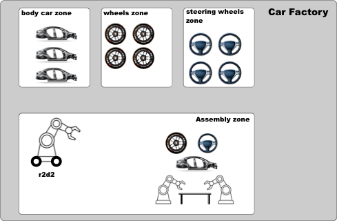
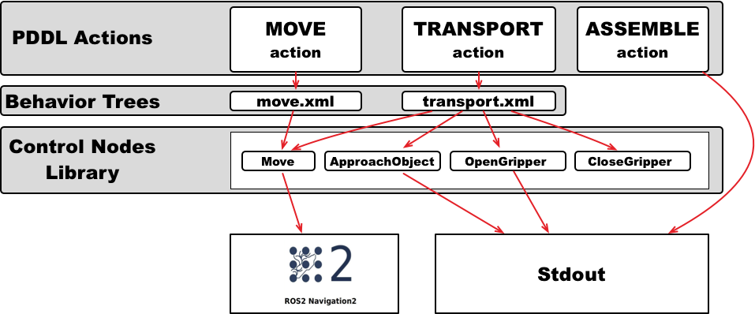

.. _bt_actions:

Implement actions as Behavior Trees
***********************************

.. raw:: html

    <h1 align="center">
      

        

          <iframe width="450" height="300" src="https://www.youtube.com/embed/_oCcIq-TN_0" frameborder="1" allowfullscreen></iframe>
        

      

    </h1>

- `Overview`_
- `Tutorial Steps`_

Overview
========

`Behavior Trees <https://en.wikipedia.org/wiki/Behavior_tree_(artificial_intelligence,_robotics_and_control)>`_ are a great way to implement actions. Instead of implementing an action, we specify an xml file with the structure of a behavior 
Tree and implement the tree nodes. This allows you to easily modify the implementation of an action, and reuse the nodes that are part of it in different behavior trees.

In PlanSys2 we will use the `BehaviorTree.CPP <https://www.behaviortree.dev/>`_ package from `Davide Faconti <https://github.com/facontidavide>`_. Read the tutorials there to 
learn more control nodes and so more sophisticated actions.

In this tutorial we are going to see an example of a car assembly factory. The robots in this factory must transport the parts of a car from the areas where they are stored to the assembly area, in order to assemble a car.

You can find the PDDL domain of this tutorial `in this file <https://github.com/PlanSys2/ros2_planning_system_examples/blob/rolling/plansys2_bt_example/pddl/bt_example.pddl>`_.

Tutorial Steps
==============

0- Requisites
-------------

If you haven't done yet, clone in your workspace and build the |PN| `examples <https://github.com/PlanSys2/ros2_planning_system_examples>`_

  .. code-block:: bash

      cd <your_workspace>
      git clone -b <ros2-distro> https://github.com/PlanSys2/ros2_planning_system_examples.git src/ros2_planning_system_examples
      rosdep install --from-paths src --ignore-src -r -y
      colcon build --symlink-install

1- Running the example
----------------------

* Open a new terminal and run |PN|:

   .. code-block:: bash

      ros2 launch plansys2_bt_example plansys2_bt_example.launch.yaml

* The robots navigate with `EasyNav <https://easynavigation.github.io>`_ (the example needs it: without it, the
  ``Move`` BT node is not built). Open a new terminal and run a node that simulates it, in which each navigation
  takes 10 s; or run the real EasyNav with a simulator instead:

   .. code-block:: bash

      ros2 run plansys2_bt_example easynav_sim_node

* Open a new terminal and run the |PN| terminal:
   
   .. code-block:: bash

      ros2 run plansys2_terminal plansys2_terminal

* In the |PN| terminal shell, copy and paste the next commands to init the knowledge of the system and set the goal:

   .. code-block:: lisp
   
      set instance r2d2 robot
      
      set instance wheels_zone zone
      set instance steering_wheels_zone zone
      set instance body_car_zone zone
      set instance assembly_zone zone
      set instance recharge_zone zone
      
      set instance wheel_1 piece
      set instance body_car_1 piece
      set instance steering_wheel_1 piece
      
      set instance wheel_2 piece
      set instance body_car_2 piece
      set instance steering_wheel_2 piece
       
      set instance wheel_3 piece
      set instance body_car_3 piece
      set instance steering_wheel_3 piece
       
      set instance car_1 car
      set instance car_2 car
      set instance car_3 car

      set predicate (robot_available r2d2)
      set predicate (robot_at r2d2 wheels_zone)
      set predicate (is_assembly_zone assembly_zone)
      set predicate (is_recharge_zone recharge_zone)
              
      set predicate (piece_at wheel_1 wheels_zone)
      set predicate (piece_at body_car_1 body_car_zone)
      set predicate (piece_at steering_wheel_1 steering_wheels_zone)
       
      set predicate (piece_is_wheel wheel_1)
      set predicate (piece_is_body_car body_car_1)
      set predicate (piece_is_steering_wheel steering_wheel_1)
      set predicate (piece_not_used wheel_1)
      set predicate (piece_not_used body_car_1)
      set predicate (piece_not_used steering_wheel_1)
       
      set goal (and(car_assembled car_1))
      run

* Alternatively, you can also copy the commands into a text file (e.g. commands.txt) and enter the following line in the |PN| terminal:

   .. code-block:: lisp
    
    source commands.txt

2- Using Behavior Trees
-----------------------

In the PDDL domain we have four actions: assemble, move, transport and recharge. We will implement the assemble action without using BTs, as we have done in the previous tutorials. 
We will implement the other three PDDL actions, ``move``, ``transport`` and ``recharge``, using BTs. For this, each action will have a BT encoded in an XML file. This XML file contains 
the control structures (sequences, fallbacks, ...) and the nodes that carry out the action. In this tutorial, 5 BT nodes have been implemented (``Move``, ``ApproachObject``, 
``OpenGripper``, ``CloseGripper`` and ``Recharge``) that can be included in the BTs of the PDDL actions.

In PlanSys2 there is a generic executable that any BT can run. This executable is ``bt_action_node`` from the package ``plansys2_bt_actions``. To use it, we should add it in 
the launch file (``launch/plansys2_bt_example.launch.yaml``), specifying as parameters the XML file that contains the BT and the PDDL action name. The example starts three
performers of ``move``, one per robot; this is the first:

  .. code-block:: yaml

       - node:
           pkg: plansys2_bt_actions
           exec: bt_action_node
           name: move_1
           namespace: $(var namespace)
           output: screen
           param:
           - from: $(find-pkg-share plansys2_bt_example)/config/params.yaml
           - {name: action_name, value: move}
           - {name: enable_groot_monitoring, value: true}
           - {name: server_port, value: 1700}
           - {name: bt_xml_file, value: $(find-pkg-share plansys2_bt_example)/behavior_trees_xml/move.xml}
 
The ``params.yaml`` contains the BT nodes that will be used in the BT. As we implement each BT as plugins, it is necessary to specify each custom node used. We can also include 
any parameter needed by the specific BT node. In this case, the coordinates (x, y and yaw) of each zone are given to the BT node ``Move`` with parameters of the performer:

  .. code-block:: yaml

       move_1:
         ros__parameters:
           plugins:
             - plansys2_move_bt_node
           waypoints: ["wheels_zone", "steering_wheels_zone", "body_car_zone", "assembly_zone", "recharge_zone"]
           waypoint_coords:
             wheels_zone: [0.0, -2.0, 0.0]
             steering_wheels_zone: [1.8, 0.0, 0.0]
             body_car_zone: [0.0, 2.0, 0.0]
             assembly_zone: [-2.0, -0.4, 0.0]
             recharge_zone: [-2.0, -0.4, 0.0]

2.1 PDDL Action move
^^^^^^^^^^^^^^^^^^^^

This is the BT for the **move** action. The sequence is not necessary, but it is maintained in the tutorial to be coherent with the available code. 
It is composed only by one BT node ``Move`` (do not confuse with PDDL action ``move``). 

  .. code-block:: xml

       <root BTCPP_format="4" main_tree_to_execute = "MainTree" >
           <BehaviorTree ID="MainTree">
              <Sequence name="root_sequence">
                  <Move    name="move" goal="{arg2}"/>
              </Sequence>
           </BehaviorTree>
       </root>

In PlanSys2, the arguments of the PDDL action are accessible in the XML through values in the blackboard whose identifiers are ``arg0``, ``arg1``, ``arg2``, and so on. If executing the 
PDDL action ``(move r2d2 wheels_zone assembly_zone)``, ``arg2`` is the destination, ``assembly_zone``.

2.2 PDDL Action transport
^^^^^^^^^^^^^^^^^^^^^^^^^

This is the BT for the **transport** action. It is implemented as a sequence of BT nodes, including reuse the BT node ``Move``. 

  .. code-block:: xml

       <root BTCPP_format="4" main_tree_to_execute = "MainTree" >
           <BehaviorTree ID="MainTree">
              <Sequence name="root_sequence">
                  <OpenGripper    name="open_gripper"/>
                  <ApproachObject name="approach_object"/>
                  <CloseGripper   name="close_gripper"/>
                  <Move    name="move" goal="{arg3}"/>
                  <OpenGripper    name="open_gripper"/>
              </Sequence>
           </BehaviorTree>
       </root>

2.3 BT Nodes
^^^^^^^^^^^^

We implemented 5 BT nodes for this tutorial. ``ApproachObject``, ``OpenGripper``, ``CloseGripper`` and ``Recharge`` have a similar implementation, showing only a message in the terminal when executing:

  .. code-block:: c++

       class ApproachObject : public BT::ActionNodeBase
       {
       public:
         explicit ApproachObject(
           const std::string & xml_tag_name,
           const BT::NodeConfiguration & conf);
       
         void halt();
         BT::NodeStatus tick();
       
         static BT::PortsList providedPorts()
         {
           return BT::PortsList({});
         }
       
       private:
         int counter_;
       };

  .. code-block:: c++

       ApproachObject::ApproachObject(
         const std::string & xml_tag_name,
         const BT::NodeConfiguration & conf)
       : BT::ActionNodeBase(xml_tag_name, conf), counter_(0)
       {
       }

       void
       ApproachObject::halt()
       {
         std::cout << "ApproachObject halt" << std::endl;
       }

       BT::NodeStatus
       ApproachObject::tick()
       {
         std::cout << "ApproachObject tick " << counter_ << std::endl;

         // Its progress, for the feedback of the action
         if (counter_++ < 5) {
           config().blackboard->set<float>("completion", counter_ / 5.0f);
           return BT::NodeStatus::RUNNING;
         } else {
           counter_ = 0;
           config().blackboard->set<float>("completion", 0.0f);
           return BT::NodeStatus::SUCCESS;
         }
       }

       }  // namespace plansys2_bt_example

       #include "behaviortree_cpp/bt_factory.h"
       BT_REGISTER_NODES(factory)
       {
         factory.registerNodeType<plansys2_bt_example::ApproachObject>("ApproachObject");
       }

``ApproachObject`` also writes its progress in the ``completion`` key of the blackboard: the performer sends it as the
feedback of the action.

The BT node ``Move`` navigates with EasyNav, through its ``easynav::GoalManagerClient``. It is a
``BT::StatefulActionNode``: ``onStart()`` is called when the node starts, ``onRunning()`` while it runs, and
``onHalted()`` if it is stopped (for instance, when the action is cancelled).

  .. code-block:: c++

       // Navigates to a waypoint with EasyNav
       class Move : public BT::StatefulActionNode
       {
       public:
         Move(const std::string & xml_tag_name, const BT::NodeConfiguration & conf);

         BT::NodeStatus onStart() override;
         BT::NodeStatus onRunning() override;
         void onHalted() override;

         static BT::PortsList providedPorts()
         {
           return {
             BT::InputPort<std::string>("goal"),
             BT::InputPort<double>(
               "server_timeout", 30.0,
               "Seconds to wait for EasyNav to be connected and to accept (it may start late)")
           };

In its constructor, ``Move`` reads the coordinates of the waypoints from the parameters of the performer, which it
gets from the blackboard (``node``, a ``rclcpp_lifecycle::LifecycleNode``). ``onStart()`` takes the destination from
the input port ``goal`` (remember the line in the XML ``<Move name="move" goal="{arg3}"/>``):

  .. code-block:: c++

       BT::NodeStatus
       Move::onStart()
       {
         std::string goal;
         if (!getInput<std::string>("goal", goal) || waypoints_.find(goal) == waypoints_.end()) {
           RCLCPP_ERROR(node_->get_logger(), "No coordinates for waypoint [%s]", goal.c_str());
           return BT::NodeStatus::FAILURE;
         }
         getInput<double>("server_timeout", server_timeout_);
         if (!navigator_) {
           return BT::NodeStatus::FAILURE;
         }

         navigator_->spin();
         switch (navigator_->client->get_state()) {
           case State::IDLE:
             break;
           case State::NAVIGATION_FINISHED:
           case State::NAVIGATION_REJECTED:
           case State::NAVIGATION_FAILED:
           case State::NAVIGATION_CANCELLED:
           case State::ERROR:
             navigator_->client->reset();
             break;
           default:  // A navigation of a previous tree still running
             renew_navigator();
         }

         goal_.header.frame_id = "map";
         goal_.header.stamp = node_->now();
         goal_.pose = waypoints_[goal];

         goal_sent_ = false;
         phase_start_ = std::chrono::steady_clock::now();
         renewed_ = phase_start_;

         return onRunning();
       }

``onRunning()`` sends the goal once EasyNav is there (waiting up to ``server_timeout`` seconds), follows the
navigation and returns ``SUCCESS`` when EasyNav reaches the goal, or ``FAILURE`` if it fails. For BT nodes that call
a ROS 2 action, ``plansys2::BtActionNode<>`` (``plansys2_bt_actions``) hides that complexity: it is enough to implement
``on_tick()``, and, if needed, ``on_success()``, ``on_aborted()`` or ``on_cancelled()``.
